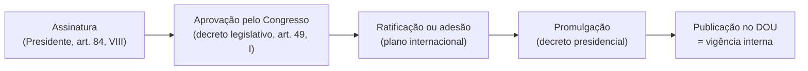
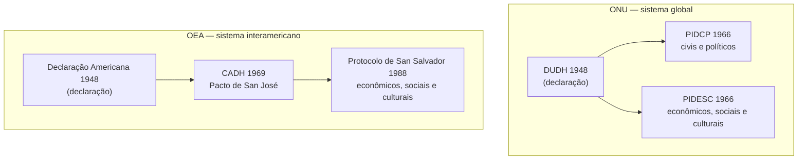
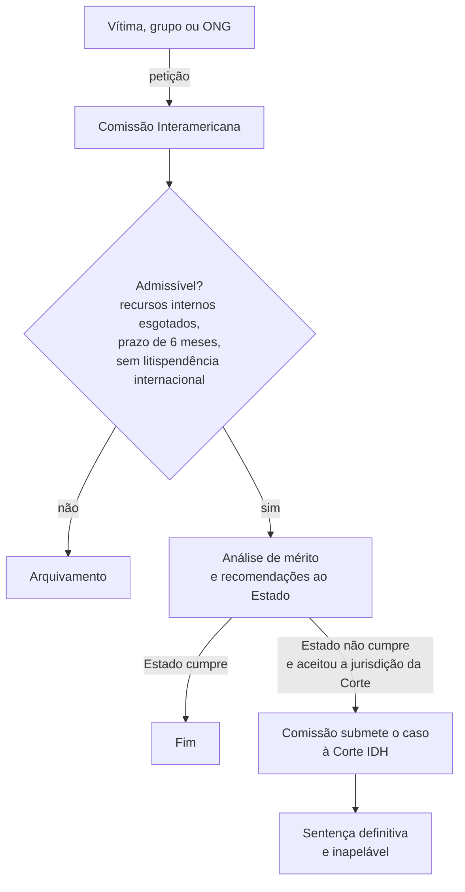
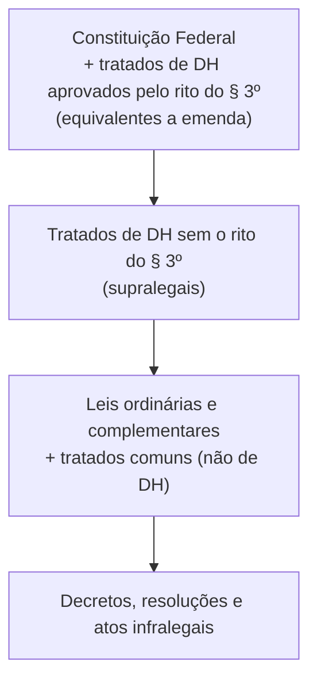

+++
title = 'Tratados de Direitos Humanos: do papel à sentença'
date = '2026-11-23'
draft = false
tags = ['semana-03', 'direitos-humanos', 'tratados', 'sidh']
categories = ['estudo']
summary = 'Como os tratados de direitos humanos nascem, entram no direito brasileiro e são cobrados: ONU, Sistema Interamericano, CF/1988, supralegalidade e controle de convencionalidade.'
+++

Direitos Humanos costuma parecer uma sopa de siglas: DUDH, PIDCP, PIDESC, CADH, CIDH, Corte IDH, CEDAW, CDPD… A FCC explora exatamente isso, trocando um instrumento pelo outro. Este post organiza o assunto por **lógica**, não por lista: primeiro como um tratado funciona, depois quem criou cada um, onde ele vale e como ele chega até um caso concreto.

Se você entender **três perguntas** para cada instrumento, quase todas as pegadinhas caem sozinhas:

1. **É declaração ou tratado?** (obriga juridicamente ou não?)
2. **De qual sistema?** (ONU, universal, ou OEA, regional?)
3. **Qual o tema?** (direitos civis, sociais, mulher, criança, deficiência…?)

---

## 1. Antes dos tratados: vocabulário que o resto pressupõe

### Declaração × tratado (soft law × hard law)

- **Declaração** é um documento de princípios aprovado por um órgão internacional (por exemplo, a Assembleia Geral da ONU). Tem enorme peso político e moral, mas **não passa por ratificação** dos Estados. É o que se chama de *soft law*.
- **Tratado** (também chamado de pacto, convenção, protocolo ou carta) é um **acordo escrito entre Estados**, que cada país aceita formalmente. Depois de aceito, **obriga juridicamente**: é *hard law*.

O exemplo central é a **Declaração Universal dos Direitos Humanos (DUDH)**, de 10/12/1948. Ela é uma resolução da Assembleia Geral da ONU, **não um tratado**. Isso não a torna irrelevante: boa parte do seu conteúdo é hoje considerada costume internacional, e ela inspirou todos os tratados que vieram depois. Mas, em prova, "DUDH é tratado ratificado pelo Brasil" é **falso**.

### Termos do ciclo de vida de um tratado

| Termo | O que significa |
|-------|-----------------|
| **Assinatura** | O Estado concorda com o texto, mas ainda não se obriga |
| **Ratificação** | Confirmação formal, no plano internacional, de que o Estado se obriga |
| **Adesão** | Entrada num tratado que o Estado não assinou na origem (efeito igual ao da ratificação) |
| **Reserva** | Declaração de que o Estado não aceita (ou interpreta de certo modo) algum dispositivo |
| **Protocolo** | Tratado acessório a outro, que acrescenta direitos ou mecanismos |
| **Entrada em vigor** | Momento em que o tratado passa a valer, em geral após um número mínimo de ratificações |

As regras gerais sobre tratados estão na **Convenção de Viena sobre o Direito dos Tratados (1969)**, promulgada no Brasil pelo Decreto 7.030/2009. Dois artigos aparecem muito:

- **Art. 26 — *pacta sunt servanda***: todo tratado em vigor obriga as partes e deve ser cumprido de **boa-fé**.
- **Art. 27**: um Estado **não pode invocar seu direito interno** para justificar o descumprimento de um tratado.

### Como um tratado entra no direito brasileiro

No Brasil, a celebração de um tratado envolve os dois Poderes políticos. Essa sequência é pré-requisito para entender o § 3º do art. 5º da Constituição:

É por isso que os tratados aparecem em prova com **número de decreto**: o decreto presidencial é o ato que promulga o tratado internamente (por exemplo, o Decreto 678/1992 promulga a Convenção Americana).

---

## 2. O sistema da ONU (sistema global ou universal)

### A "Carta Internacional dos Direitos Humanos"

Depois da DUDH, a ONU queria transformar aqueles princípios em obrigações jurídicas. Por causa da Guerra Fria, o conteúdo foi dividido em **dois tratados**, adotados no mesmo dia, **16/12/1966**:

| Pacto | Sigla | Conteúdo | Vigor internacional | Brasil |
|-------|-------|----------|--------------------|--------|
| Pacto Internacional sobre Direitos **Civis e Políticos** | **PIDCP** | Vida, liberdade, devido processo, expressão, religião, participação política | 1976 | **Decreto 592/1992** |
| Pacto Internacional sobre Direitos **Econômicos, Sociais e Culturais** | **PIDESC** | Trabalho, saúde, educação, previdência, moradia, cultura | 1976 | **Decreto 591/1992** |

A DUDH, os dois Pactos e seus protocolos formam o que a doutrina chama de **Carta Internacional dos Direitos Humanos** (*International Bill of Rights*).


**Troca clássica:** 591 = PIDESC, 592 = PIDCP. Para memorizar: **"social vem primeiro"**. O Decreto 591, o número menor, é o dos direitos **sociais**.


### Por que dois pactos? A diferença na forma de cumprir

A divisão não é só temática. Os dois pactos impõem **tipos diferentes de obrigação**:

- **PIDCP — aplicação imediata.** O Estado deve respeitar e garantir os direitos desde já. Não existe "vou deixar de torturar aos poucos".
- **PIDESC — realização progressiva.** Pelo art. 2º, o Estado se compromete a adotar medidas "até o máximo de seus recursos disponíveis", visando alcançar **progressivamente** a plena efetividade dos direitos. Construir um sistema de saúde leva tempo e dinheiro.

Isso **não significa** que os direitos sociais valem menos. Dois pontos impedem essa leitura:

- **Indivisibilidade e interdependência:** a Conferência de Viena (1993) afirmou que todos os direitos humanos são universais, indivisíveis, interdependentes e inter-relacionados. Não há hierarquia entre "civis" e "sociais".
- **Proibição de retrocesso (não regressão):** se o Estado já alcançou certo nível de proteção social, não pode recuar sem justificativa.

### Quem fiscaliza os pactos

Cada tratado da ONU tem um **órgão de tratado** (um comitê de especialistas independentes) que acompanha seu cumprimento, principalmente por meio de **relatórios periódicos** enviados pelos Estados.

| Tratado | Órgão de controle | Detalhes que a FCC já cobrou |
|---------|-------------------|------------------------------|
| PIDCP | **Comitê de Direitos Humanos** | **18 membros** (art. 28), eleitos em **escrutínio secreto**; analisa relatórios (art. 40); comunicações entre Estados (art. 41), com possível **Comissão de Conciliação *ad hoc*** (art. 42) |
| PIDESC | **Comitê de Direitos Econômicos, Sociais e Culturais** | Relatórios são enviados ao **Secretário-Geral da ONU**, que os encaminha ao **Conselho Econômico e Social (ECOSOC)** (art. 16). O Comitê DESC foi criado depois, por resolução do ECOSOC (1985) |


**Pegadinha real (FCC, TRT-11, 2024):** uma assertiva dizia que os relatórios do PIDESC iam ao "Secretário-Geral da **Organização dos Estados Americanos**". Errado: o PIDESC é da **ONU**. Outra (TRT-1, 2025) dizia que o Comitê de Direitos Humanos tem **27** membros. Errado: são **18**.


O nome "Comitê de Direitos Humanos" engana. Ele é da **ONU** e fiscaliza o **PIDCP**. Não tem relação com a Comissão Interamericana nem com a antiga Comissão de Direitos Humanos da ONU (substituída em 2006 pelo **Conselho de Direitos Humanos**, que é um órgão político, e não de tratado).

### Os protocolos facultativos

| Protocolo | O que acrescenta |
|-----------|------------------|
| **1º Protocolo Facultativo ao PIDCP** (1966) | Permite **petições individuais** ao Comitê de Direitos Humanos |
| **2º Protocolo Facultativo ao PIDCP** (1989) | Compromisso com a **abolição da pena de morte** |
| **Protocolo Facultativo ao PIDESC** (2008) | Cria mecanismo de comunicações sobre direitos sociais |

"Facultativo" quer dizer que o Estado pode ser parte do Pacto sem ser parte do Protocolo. O Brasil aderiu aos dois protocolos do PIDCP em 2009, com reserva ao 2º para admitir a pena de morte em caso de guerra declarada, coerente com o art. 5º, XLVII, *a*, da Constituição.

### As convenções temáticas

Além dos pactos gerais, a ONU criou tratados para grupos ou temas específicos. A prova quer, sobretudo, que você **associe o tratado ao grupo**:

| Grupo ou tema | Instrumento | Ano | Ideia central |
|---------------|-------------|-----|---------------|
| **Raça** | Convenção sobre a Eliminação de Todas as Formas de Discriminação Racial (**CERD**) | 1965 | Proíbe discriminação racial e admite **ações afirmativas** temporárias |
| **Mulher** | Convenção sobre a Eliminação de Todas as Formas de Discriminação contra a Mulher (**CEDAW**) | 1979 | Igualdade material entre homens e mulheres |
| **Tortura** | Convenção contra a Tortura | 1984 | Proibição absoluta, sem exceção em guerra ou emergência |
| **Criança** | Convenção sobre os Direitos da Criança (**CDC**) | 1989 | **Interesse superior da criança**; criança como sujeito de direitos |
| **Pessoa com deficiência** | Convenção sobre os Direitos das Pessoas com Deficiência (**CDPD**) | 2006 | **Modelo social** da deficiência |

O **modelo social** da CDPD merece atenção. A deficiência deixa de ser vista como "um problema da pessoa" (modelo médico) e passa a resultar da **interação** entre o impedimento e as **barreiras** do ambiente. A obrigação do Estado é remover barreiras, e não "consertar" a pessoa. No Brasil, essa visão foi incorporada pela Lei Brasileira de Inclusão (Lei 13.146/2015).

---

## 3. O Sistema Interamericano (sistema regional)

Além do sistema global da ONU, existem **sistemas regionais**: europeu, africano e interamericano. O que vale para o Brasil é o **Sistema Interamericano de Direitos Humanos (SIDH)**, vinculado à **Organização dos Estados Americanos (OEA)**, criada em 1948.

Os sistemas global e regional **não competem: se complementam**. Uma pessoa pode, em tese, recorrer a qualquer um deles, desde que respeite as regras de admissibilidade de cada sistema.

### As peças do SIDH

| Peça | Natureza | Dados-chave |
|------|----------|-------------|
| **Declaração Americana dos Direitos e Deveres do Homem** | Declaração | Bogotá, **abril de 1948**, alguns meses **antes** da DUDH |
| **Convenção Americana sobre Direitos Humanos (CADH)**, o **Pacto de San José da Costa Rica** | Tratado | Assinada em 1969; vigor em 1978; Brasil: **Decreto 678/1992** |
| **Protocolo de San Salvador** | Protocolo à CADH | 1988; direitos **econômicos, sociais e culturais** no sistema interamericano; Brasil: **Decreto 3.321/1999** |
| **Comissão Interamericana de Direitos Humanos (CIDH)** | Órgão da OEA e da CADH | Sede em **Washington**; 7 membros; recebe **petições** e monitora |
| **Corte Interamericana de Direitos Humanos (Corte IDH)** | Tribunal | Sede em **San José (Costa Rica)**; 7 juízes; funções **contenciosa** e **consultiva** |

Repare no paralelo com a ONU: assim como a DUDH foi seguida pelos Pactos, a Declaração Americana foi seguida pela CADH. E, assim como o PIDESC cuida dos direitos sociais no plano global, o Protocolo de San Salvador cuida deles no plano regional.

### Comissão × Corte: o caminho de um caso

Este é o ponto mais cobrado e o mais confundido. A Comissão e a Corte **não são duas instâncias iguais**. Elas têm papéis diferentes:

- A **Comissão** é a porta de entrada. **Qualquer pessoa, grupo ou ONG** pode apresentar uma petição a ela (art. 44 da CADH).
- A **Corte** é o tribunal. **Somente os Estados-partes e a Comissão** podem submeter casos à Corte (art. 61). A vítima **não aciona a Corte diretamente**, embora hoje participe do processo depois que o caso chega lá.

Os requisitos de admissibilidade (art. 46 da CADH) explicam a lógica do sistema, que é **subsidiário**: o Estado tem a chance de resolver o problema internamente antes de ser chamado no plano internacional.

1. **Esgotamento dos recursos internos**, salvo quando eles não existem, não são acessíveis ou há demora injustificada.
2. Petição apresentada em até **6 meses** da decisão interna definitiva.
3. A mesma questão **não pode estar pendente** em outro processo internacional.

### O Brasil no SIDH

| Marco | Data |
|-------|------|
| Promulgação da CADH | **1992** (Decreto 678) |
| Reconhecimento da competência contenciosa da Corte IDH | **1998** (Decreto Legislativo 89/1998, com promulgação pelo Decreto 4.463/2002) |

Casos que ajudam a fixar a diferença entre Comissão e Corte:

| Caso | Onde foi decidido | Por que importa |
|------|-------------------|-----------------|
| **Maria da Penha** (2001) | **Comissão** | Responsabilizou o Brasil por tolerância à violência doméstica; influenciou a Lei 11.340/2006 |
| **Ximenes Lopes** (2006) | **Corte** | **Primeira condenação** do Brasil na Corte IDH (morte de paciente em clínica psiquiátrica) |
| **Gomes Lund — Guerrilha do Araguaia** (2010) | **Corte** | Considerou a Lei de Anistia incompatível com a CADH quanto a graves violações |
| **Trabalhadores da Fazenda Brasil Verde** (2016) | **Corte** | Primeiro caso da Corte sobre **trabalho escravo** contemporâneo; tema com relação direta com a Justiça do Trabalho |


**Maria da Penha não é sentença da Corte IDH.** O caso foi decidido pela **Comissão**, em relatório de 2001. É uma troca frequente.


### Corte IDH × outros tribunais internacionais

| Tribunal | Quem julga | Base |
|----------|------------|------|
| **Corte IDH** | **Estados** por violar a CADH | Sistema interamericano |
| **Tribunal Penal Internacional (TPI)** | **Indivíduos** por genocídio, crimes contra a humanidade, crimes de guerra e agressão | Estatuto de Roma (1998); Brasil: Decreto 4.388/2002; sede em Haia |
| **Corte Internacional de Justiça (CIJ)** | Litígios **entre Estados** em geral | Carta da ONU (1945) |

A Constituição também tem um dispositivo sobre o TPI. Pelo art. 5º, § 4º (incluído pela EC 45/2004), o Brasil se submete à jurisdição do TPI a cuja criação tenha manifestado adesão.

---

## 4. Tratados de direitos humanos e a Constituição de 1988

Depois de entender de onde vêm os tratados, a pergunta passa a ser: **que força eles têm dentro do Brasil?**

### Os dispositivos

- **Art. 5º, § 2º (texto original de 1988):** os direitos e garantias da Constituição **não excluem** outros decorrentes do regime e dos princípios por ela adotados ou dos **tratados** de que o Brasil seja parte. É uma **cláusula de abertura**: a lista de direitos fundamentais não é fechada.
- **Art. 5º, § 3º (EC 45/2004):** tratados e convenções **sobre direitos humanos** aprovados **em cada Casa do Congresso**, em **dois turnos**, por **três quintos** dos votos dos respectivos membros, serão **equivalentes às emendas constitucionais**.

Repare que o quórum do § 3º é o mesmo de uma emenda constitucional (art. 60, § 2º). Faz sentido: se o tratado vai ter força de emenda, precisa passar pelo mesmo rito.

### A hierarquia segundo o STF

Ficava uma dúvida: e os tratados de direitos humanos aprovados **antes** de 2004, ou aprovados depois **sem** o rito do § 3º? No **RE 466.343 (2008)**, o STF firmou a tese da **supralegalidade**: esses tratados ficam **abaixo da Constituição** e **acima das leis**.

Três níveis para guardar:

| Tipo de tratado | Status |
|-----------------|--------|
| Direitos humanos **com** rito do § 3º | **Equivalente a emenda constitucional** |
| Direitos humanos **sem** rito do § 3º | **Supralegal** |
| Tratado **comum** (comércio, tributação etc.) | **Lei ordinária** |

Na doutrina, há quem defenda que todo tratado de direitos humanos já seria materialmente constitucional, com base no § 2º (posição do ministro Celso de Mello e de Flávia Piovesan, por exemplo). Para prova objetiva, a regra é a tese **majoritária do STF**: supralegalidade.

### O caso que gerou a tese: depositário infiel

A Constituição admite, no art. 5º, LXVII, a prisão civil do devedor de alimentos **e** do **depositário infiel**. Já a CADH (art. 7º, 7) só admite prisão por dívida no caso de **obrigação alimentar**.

Como a CADH é supralegal, ela **paralisa a eficácia** das leis que regulamentavam a prisão do depositário infiel. O texto da Constituição não foi revogado, mas perdeu aplicação prática por falta de lei válida que o regulamente. Daí a **Súmula Vinculante 25**: é ilícita a prisão civil de depositário infiel, qualquer que seja a modalidade do depósito.


A FCC cobrou exatamente esse artigo da CADH (TRT-7, 2024): "Ninguém deve ser detido por dívida. Este princípio não limita os mandados de autoridade judiciária competente expedidos em virtude de inadimplemento de obrigação alimentar." **Correto.**


### Quais tratados têm status de emenda constitucional?

Poucos. Até hoje, os aprovados pelo rito do § 3º são:

| Tratado | Promulgação |
|---------|-------------|
| **Convenção sobre os Direitos das Pessoas com Deficiência** + Protocolo Facultativo | Decreto 6.949/2009 |
| **Tratado de Marraqueche** (acesso a obras publicadas por pessoas cegas ou com deficiência visual) | Decreto 9.522/2018 |
| **Convenção Interamericana contra o Racismo, a Discriminação Racial e Formas Correlatas de Intolerância** | Decreto 10.932/2022 |

Em prova, o exemplo mais comum continua sendo a **CDPD**. Mas, se aparecer a Convenção Interamericana contra o Racismo com status de emenda, a afirmação está **correta**. E a **CADH não tem** status de emenda: ela é supralegal, porque foi aprovada em 1992, antes do § 3º existir.

---

## 5. Controle de convencionalidade

### A ideia

Você já conhece o **controle de constitucionalidade**: verificar se uma lei é compatível com a **Constituição**. O **controle de convencionalidade** faz a mesma pergunta, mas com outro parâmetro: a lei é compatível com os **tratados de direitos humanos**?

| | Controle de constitucionalidade | Controle de convencionalidade |
|---|---|---|
| **Parâmetro** | Constituição Federal | Tratados de direitos humanos (em especial a CADH) e a jurisprudência da Corte IDH |
| **Resultado típico** | Lei declarada inconstitucional | Lei interna **afastada** por incompatibilidade com o tratado |

Os dois controles **convivem**. Uma lei pode passar no teste da Constituição e falhar no da Convenção, como aconteceu com a prisão do depositário infiel.

### De onde vem e quem faz

A expressão foi consolidada pela própria **Corte IDH**, no caso **Almonacid Arellano vs. Chile (2006)**. A Corte afirmou que os juízes nacionais devem verificar a compatibilidade das normas internas com a CADH, levando em conta também a interpretação que a própria Corte dá à Convenção. No mesmo ano, no caso *Trabajadores Cesados del Congreso vs. Peru*, acrescentou que esse controle deve ser feito **de ofício**.

Isso gera dois planos:

- **Controle internacional:** feito pela Corte IDH, ao julgar o Estado.
- **Controle interno:** feito por **qualquer juiz ou tribunal** do país, inclusive um juiz do trabalho de primeira instância, ao deixar de aplicar uma norma incompatível com a Convenção.

No Brasil, como a CADH é supralegal, o controle de convencionalidade de leis ordinárias funciona de forma parecida com o controle difuso: o juiz deixa de aplicar a lei no caso concreto. O CNJ reforçou essa orientação na Recomendação 123/2022, que recomenda aos órgãos do Judiciário observar os tratados de direitos humanos e a jurisprudência da Corte IDH.

---

## 6. Como se interpretam os tratados de direitos humanos

Os tratados de direitos humanos têm uma particularidade: eles não criam vantagens recíprocas entre Estados, e sim **obrigações dos Estados para com as pessoas**. Por isso, a interpretação segue princípios próprios:

| Princípio | O que diz | Base |
|-----------|-----------|------|
| **Boa-fé** | Interpretar e cumprir o tratado de forma leal | Convenção de Viena, arts. 26 e 31 |
| ***Pro persona*** (ou *pro homine*) | Na dúvida, ou havendo várias normas aplicáveis, prevalece a **mais favorável** à pessoa, seja interna ou internacional | CADH, art. 29 |
| **Efetividade** | Preferir a leitura que torne o direito real, e não meramente formal | Jurisprudência da Corte IDH |
| **Interpretação evolutiva** | Tratados são "instrumentos vivos": o sentido acompanha as condições atuais | Jurisprudência da Corte IDH |
| **Não regressão** | Proteção alcançada não pode recuar sem justificativa | Especialmente para direitos sociais |

O art. 29 da CADH merece uma leitura. Ele diz que nenhuma disposição da Convenção pode ser interpretada para:

- permitir que um Estado suprima ou limite direitos além do que a Convenção admite;
- limitar direitos reconhecidos por leis internas ou por outros tratados;
- excluir outros direitos inerentes ao ser humano ou decorrentes da forma democrática de governo.

Na prática, a Convenção funciona como um **piso**, nunca como um teto. A FCC já usou esse texto como alternativa correta (TRT-11, 2024).

Quando dois direitos colidem, como liberdade de expressão e privacidade, a solução é a **ponderação** com base na proporcionalidade, analisando o caso concreto. Não existe hierarquia fixa do tipo "direitos civis valem mais que sociais".

---

## 7. Outros instrumentos do edital (visão de mapa)

O edital menciona alguns instrumentos que aparecem pouco, mas que precisam ser reconhecidos pelo nome:

| Instrumento | Natureza | Ideia central |
|-------------|----------|---------------|
| **Declaração de Estocolmo** (1972) | Declaração (ONU) | Primeira grande conferência sobre meio ambiente humano; liga meio ambiente saudável a direitos humanos |
| **Convenção sobre Diversidade Biológica** (Rio, 1992) | Tratado (ONU) | Conservação da biodiversidade, uso sustentável e repartição justa dos benefícios; Brasil: Decreto 2.519/1998 |
| **Convenção 169 da OIT** (1989) | Tratado (OIT) | Povos indígenas e tribais: **autoidentificação** e direito à **consulta prévia, livre e informada**; Brasil: Decreto 5.051/2004, hoje consolidado no Decreto 10.088/2019 |
| **Declaração da ONU sobre os Direitos dos Povos Indígenas** (2007) | Declaração | Autodeterminação, terras, cultura |

Note o padrão: Estocolmo é **declaração**, enquanto a Diversidade Biológica é **tratado**. Para povos indígenas, a Convenção 169 é o **tratado**, e a Declaração de 2007 é *soft law*.

---

## 8. Mecanismos de proteção: os três níveis

Juntando tudo, a proteção aos direitos humanos opera em camadas:

| Nível | Exemplos |
|-------|----------|
| **Global (ONU)** | Comitês dos tratados (relatórios, petições individuais, comunicações entre Estados); Conselho de Direitos Humanos |
| **Regional (OEA)** | Comissão Interamericana (petições, medidas cautelares, relatórios) e Corte IDH (sentenças, medidas provisórias, opiniões consultivas) |
| **Nacional** | Constituição, leis, Judiciário, Ministério Público, Defensoria; no Judiciário, resoluções do CNJ e do CSJT |

Um mecanismo nacional pouco lembrado, mas útil para entender o todo, é o **Incidente de Deslocamento de Competência** (art. 109, § 5º, da CF, incluído pela EC 45/2004). Em casos de grave violação de direitos humanos, o **Procurador-Geral da República** pode pedir ao **STJ** que o caso seja transferido para a **Justiça Federal**. O objetivo é evitar que o Brasil seja responsabilizado internacionalmente por falha das instâncias locais, já que, perante a Corte IDH, quem responde é sempre a **União**, como representante do Estado brasileiro.

---

## 9. Pegadinhas que a FCC repete

| A banca diz | Por que está errado |
|-------------|---------------------|
| "A DUDH é tratado com status de emenda constitucional" | A DUDH é declaração, não tratado ratificado |
| "Todo tratado internacional aprovado por 3/5 vale como emenda" | Só os tratados de **direitos humanos** |
| "A CADH tem status de emenda constitucional" | A CADH é **supralegal** (aprovada antes do § 3º) |
| "O Protocolo de San Salvador é protocolo ao PIDESC" | É protocolo à **CADH**, do sistema interamericano |
| "A vítima pode processar o Estado diretamente na Corte IDH" | Só Estados e a **Comissão** submetem casos à Corte |
| "A Corte IDH julga indivíduos por crimes contra a humanidade" | Isso é o **TPI**; a Corte IDH julga **Estados** |
| "O Comitê de Direitos Humanos é órgão da OEA" | É órgão da **ONU** e fiscaliza o **PIDCP** |
| "O Comitê de Direitos Humanos tem 27 membros" | Tem **18** |
| "Relatórios do PIDESC vão ao Secretário-Geral da OEA" | Vão ao Secretário-Geral da **ONU** e, dele, ao **ECOSOC** |
| "Decreto 591 promulga o PIDCP" | 591 é o **PIDESC**; 592 é o PIDCP |
| "Serviços exigidos em calamidade são trabalho forçado" | Tanto o PIDCP (art. 8º) quanto a CADH (art. 6º) **excluem** esses serviços do conceito de trabalho forçado |
| "O caso Maria da Penha foi sentença da Corte IDH" | Foi decidido pela **Comissão** |

---

## 10. Teste rápido

**1.** Um tratado sobre direitos humanos foi aprovado pelo Congresso em 2010, por maioria simples, em turno único. Qual o seu status?

Resposta

**Supralegal.** É de direitos humanos, mas não seguiu o rito do § 3º (dois turnos, 3/5, em cada Casa).

**2.** Uma ONG brasileira quer levar à Corte IDH um caso de violência policial. Qual o caminho?

Resposta

Apresentar petição à **Comissão Interamericana**, depois de esgotados os recursos internos (ou demonstrada a exceção) e dentro de 6 meses da decisão definitiva. Só a Comissão (ou um Estado) pode submeter o caso à Corte.

**3.** Um juiz do trabalho deixa de aplicar uma lei por considerá-la incompatível com a CADH, embora ela seja compatível com a Constituição. Que controle ele exerceu?

Resposta

**Controle de convencionalidade**, na forma difusa e interna. O parâmetro foi o tratado, e não a Constituição.

---

## Resumo

- **Declaração** (DUDH, Declaração Americana, Estocolmo) é *soft law*. **Tratado** (PIDCP, PIDESC, CADH, CEDAW, CDPD…) obriga juridicamente.
- **ONU:** DUDH (1948) → PIDCP e PIDESC (1966; no Brasil, Decretos **592** e **591** de 1992) → convenções temáticas (raça, mulher, tortura, criança, deficiência).
- **PIDCP** tem aplicação imediata; **PIDESC** tem realização progressiva, mas sem hierarquia entre eles (indivisibilidade).
- **OEA:** Declaração Americana (1948) → **CADH / Pacto de San José** (1969; Decreto 678/1992) → **San Salvador** (direitos sociais).
- **Comissão** recebe petições de qualquer pessoa; **Corte** julga, mas só recebe casos da Comissão ou de Estados. Brasil aceitou a jurisdição da Corte em **1998**.
- Tratado de direitos humanos **com** rito do § 3º = **emenda constitucional** (CDPD, Marraqueche, Convenção contra o Racismo). **Sem** rito = **supralegal** (CADH). Tratado comum = **lei ordinária**.
- **Controle de convencionalidade** usa os tratados como parâmetro; pode ser feito por qualquer juiz, inclusive de ofício.
- Interpretação **pro persona**: vale a norma mais favorável à pessoa; o tratado é piso, não teto.

## Para aprofundar

- [Constituição Federal — art. 5º](https://www.planalto.gov.br/ccivil_03/constituicao/constituicao.htm)
- [Decreto 592/1992 — PIDCP](https://www.planalto.gov.br/ccivil_03/decreto/1990-1994/d0592.htm)
- [Decreto 591/1992 — PIDESC](https://www.planalto.gov.br/ccivil_03/decreto/1990-1994/d0591.htm)
- [Decreto 678/1992 — Convenção Americana (Pacto de San José)](https://www.planalto.gov.br/ccivil_03/decreto/d0678.htm)
- [Decreto 3.321/1999 — Protocolo de San Salvador](https://www.planalto.gov.br/ccivil_03/decreto/d3321.htm)
- [Decreto 6.949/2009 — Convenção sobre os Direitos das Pessoas com Deficiência](https://www.planalto.gov.br/ccivil_03/_ato2007-2010/2009/decreto/d6949.htm)
- [Corte Interamericana de Direitos Humanos](https://www.corteidh.or.cr/)
- [Comissão Interamericana de Direitos Humanos](https://www.oas.org/pt/cidh/)
- [Escritório do Alto Comissariado da ONU para os Direitos Humanos](https://www.ohchr.org/)

[Ver todos os posts]()
